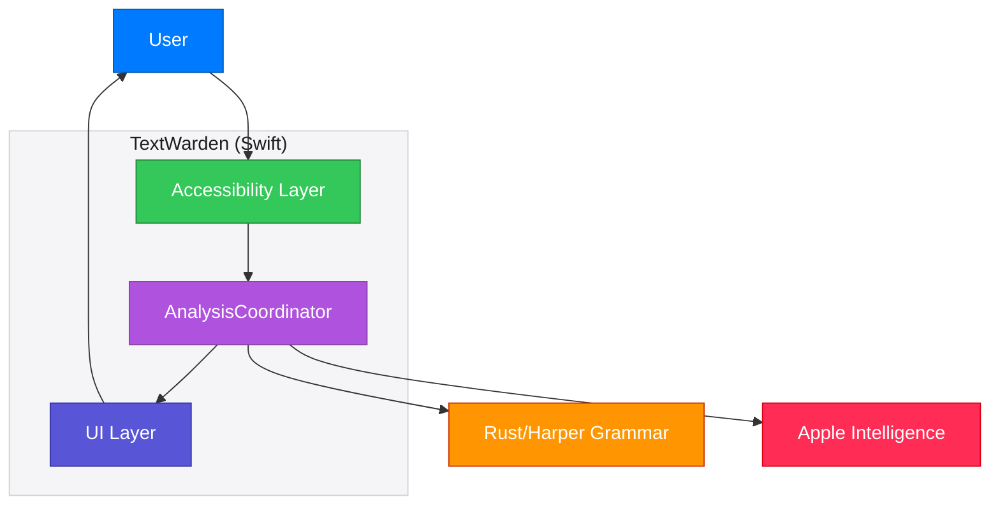
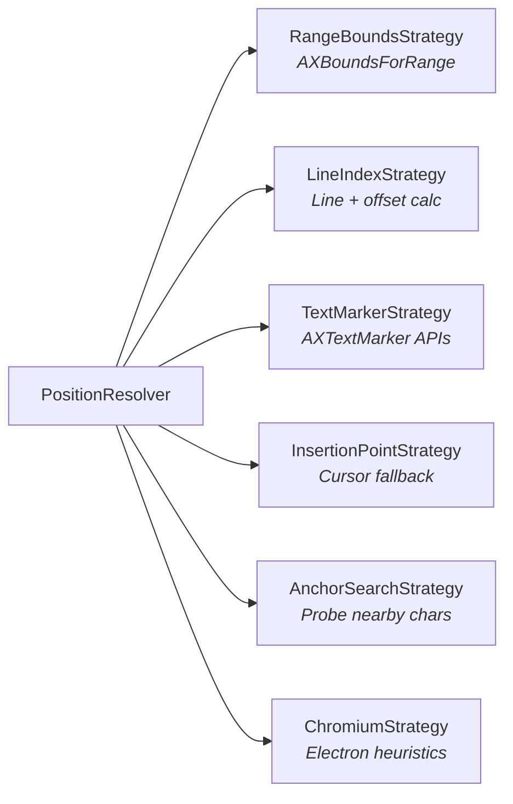
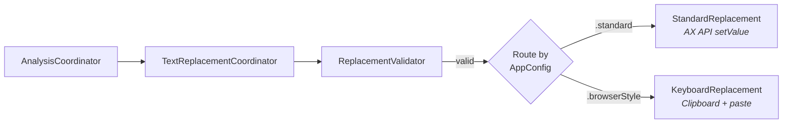
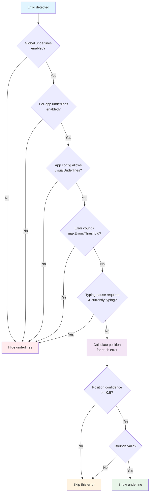
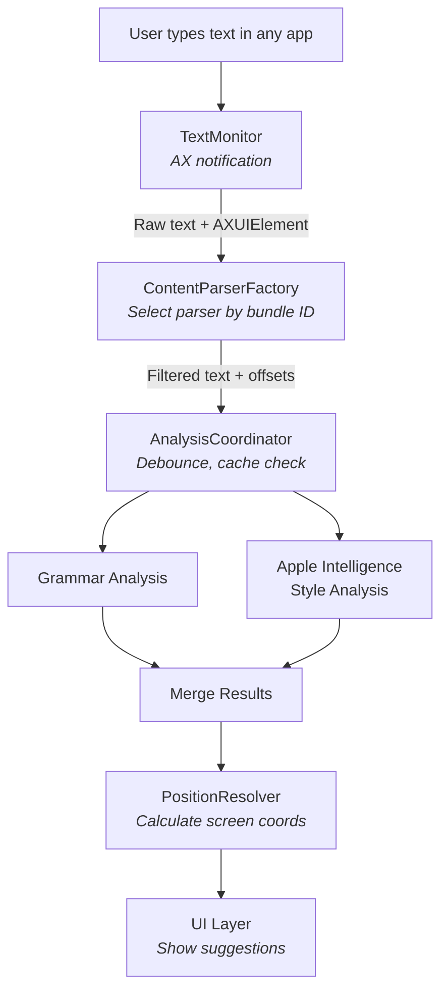
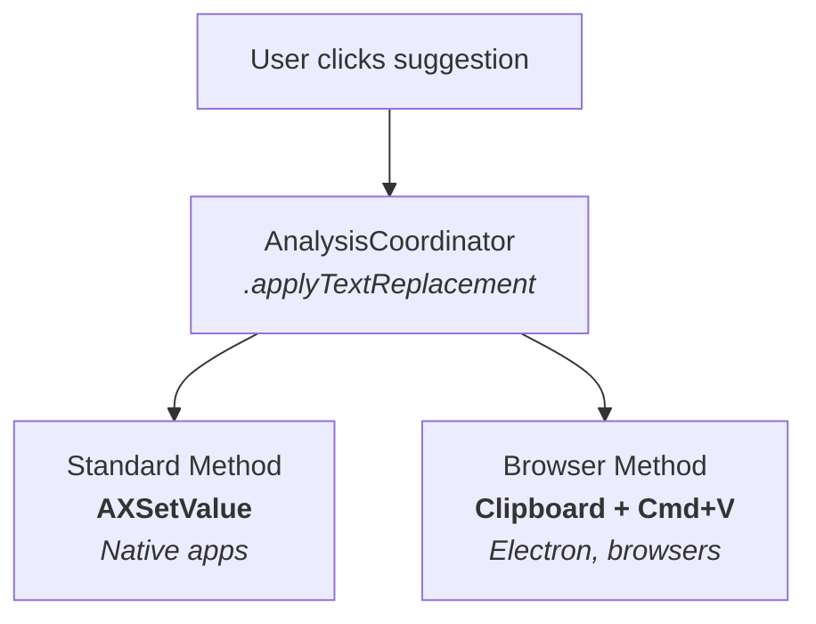

# TextWarden Architecture

This document describes the architecture, design patterns, and coding principles for the TextWarden codebase. It's intended for contributors who want to understand how the system works and how to write code that fits the existing patterns.

## High-Level Overview

TextWarden is a macOS menu bar application that monitors text input across all applications and provides grammar checking and style suggestions in real-time.



**Swift Layer** handles:
- macOS Accessibility API integration (monitoring text changes)
- Application-specific text parsing and filtering
- Error position calculation for visual underlines
- UI rendering (suggestion popovers, error indicators)
- Text replacement operations
- Apple Intelligence integration via FoundationModelsEngine

**Rust Layer** (GrammarEngine) handles:
- Grammar analysis via Harper library
- Language detection via whichlang
- Custom vocabulary support (slang, IT terms, brand names)

**Apple Intelligence** (macOS 26+):
- Style suggestions via Foundation Models framework
- On-device processing with complete privacy
- Writing style adaptation (formal, casual, concise, business)

## Directory Structure

```
Sources/
├── App/                                          # Application lifecycle and orchestration
│   ├── TextWardenApp.swift                       # Main entry point (@main)
│   ├── AnalysisCoordinator.swift                 # Central orchestrator
│   ├── AnalysisCoordinator+GrammarAnalysis.swift # Grammar analysis extension
│   ├── AnalysisCoordinator+StyleChecking.swift   # Style checking extension
│   ├── AnalysisCoordinator+TextReplacement.swift # Text replacement extension
│   ├── AnalysisCoordinator+WindowTracking.swift  # Window tracking extension
│   ├── FoundationModelsEngine.swift              # Apple Intelligence integration
│   ├── StyleInstructions.swift                   # AI prompt templates
│   ├── StyleTypes+Generable.swift                # @Generable structs for AI output
│   ├── AIRephraseCache.swift                     # Cache for AI rephrase suggestions
│   ├── MenuBarController.swift                   # Menu bar UI
│   ├── PreferencesWindowController.swift         # Preferences window management
│   ├── Dependencies.swift                        # Dependency injection container
│   ├── UpdaterViewModel.swift                    # Sparkle auto-updater
│   ├── CrashRecoveryManager.swift                # Crash detection and recovery
│   └── VirtualKeyCodes.swift                     # Keyboard event codes
│
├── Accessibility/                                # macOS Accessibility API layer
│   ├── TextMonitor.swift                         # Monitors text changes via AX observers
│   ├── ApplicationTracker.swift                  # Tracks active app/window focus
│   ├── PermissionManager.swift                   # Accessibility permission handling
│   ├── BrowserURLExtractor.swift                 # Extracts URLs from browser address bars
│   └── CGWindowHelper.swift                      # Window-level helpers
│
├── ContentParsers/                               # App-specific text extraction
│   ├── ContentParser.swift                       # Protocol definition
│   ├── ContentParserFactory.swift                # Factory for parser instantiation
│   ├── GenericContentParser.swift                # Default parser
│   ├── BrowserContentParser.swift                # Chrome, Safari, Firefox, Arc
│   ├── SlackContentParser.swift                  # Slack rich text handling
│   ├── NotionContentParser.swift                 # Notion blocks parsing
│   ├── MailContentParser.swift                   # Apple Mail
│   ├── ClaudeContentParser.swift                 # Claude AI desktop app
│   ├── OutlookContentParser.swift                # Microsoft Outlook
│   ├── WebExContentParser.swift                  # Cisco WebEx
│   ├── WordContentParser.swift                   # Microsoft Word
│   ├── PowerPointContentParser.swift             # Microsoft PowerPoint
│   └── TeamsContentParser.swift                  # Microsoft Teams
│
├── Positioning/                                  # Error underline position calculation
│   ├── PositionResolver.swift                    # Strategy orchestrator
│   ├── AccessibilityBridge.swift                 # AX API helpers
│   ├── CoordinateMapper.swift                    # Quartz ↔ Cocoa coordinate conversion
│   ├── GeometryProvider.swift                    # Strategy protocol
│   ├── GeometryConstants.swift                   # Bounds validation constants
│   ├── PositionCache.swift                       # Position caching
│   ├── PositionRefreshCoordinator.swift          # App-specific refresh triggers
│   ├── TypingDetector.swift                      # Detects typing pauses
│   ├── TextAnchor.swift                          # Text anchor utilities
│   └── Strategies/                               # Positioning algorithms
│       ├── SlackStrategy.swift                   # Dedicated Slack positioning
│       ├── ClaudeStrategy.swift                  # Claude AI tree-traversal positioning
│       ├── NotionStrategy.swift                  # Notion-specific positioning
│       ├── OutlookStrategy.swift                 # Microsoft Outlook positioning
│       ├── TeamsStrategy.swift                   # Microsoft Teams positioning
│       ├── WordStrategy.swift                    # Microsoft Word positioning
│       ├── PowerPointStrategy.swift              # Microsoft PowerPoint positioning
│       ├── MailStrategy.swift                    # Apple Mail positioning
│       ├── WebExStrategy.swift                   # Cisco WebEx positioning
│       ├── ProtonMailStrategy.swift              # Proton Mail positioning
│       ├── RangeBoundsStrategy.swift             # AXBoundsForRange
│       ├── LineIndexStrategy.swift               # Line + offset calculation
│       ├── TextMarkerStrategy.swift              # AXTextMarker APIs
│       ├── InsertionPointStrategy.swift          # Cursor-based fallback
│       ├── AnchorSearchStrategy.swift            # Probe nearby characters
│       ├── ChromiumStrategy.swift                # Electron/Chromium heuristics
│       ├── FontMetricsStrategy.swift             # Font-based calculation
│       ├── ElementTreeStrategy.swift             # Element hierarchy traversal
│       └── OriginStrategy.swift                  # Origin-based positioning
│
├── TextReplacement/                              # Text replacement operations
│   ├── TextReplacementCoordinator.swift          # Main entry point, routes by method
│   ├── ReplacementContext.swift                  # Context object with resolved indices
│   ├── ReplacementResult.swift                   # Result types for operations
│   ├── Methods/                                  # Replacement method implementations
│   │   ├── StandardReplacement.swift             # AX API setValue (native apps)
│   │   └── KeyboardReplacement.swift             # Clipboard + paste (Electron/browser)
│   └── Infrastructure/                           # Shared components
│       └── ReplacementValidator.swift            # Text validation before replace
│
├── AppConfiguration/                             # Per-application settings
│   ├── AppRegistry.swift                         # App registration and feature flags
│   ├── AppConfiguration.swift                    # Configuration data model
│   ├── AppBehavior.swift                         # Per-app behavior protocol
│   ├── AppBehaviorRegistry.swift                 # Central registry for app behaviors
│   ├── BehaviorTypes.swift                       # Behavior value types (quirks, timing, etc.)
│   ├── Behaviors/                                # Per-app behavior specifications
│   │   ├── SlackBehavior.swift                   # Slack-specific behavior
│   │   ├── NotionBehavior.swift                  # Notion-specific behavior
│   │   ├── WordBehavior.swift                    # Microsoft Word behavior
│   │   ├── OutlookBehavior.swift                 # Microsoft Outlook behavior
│   │   ├── TeamsBehavior.swift                   # Microsoft Teams behavior
│   │   └── (20+ more app behaviors)              # One file per supported app
│   ├── StrategyProfiler.swift                    # Auto-detection of app capabilities
│   ├── StrategyProfileCache.swift                # Disk cache for profiles
│   ├── StrategyRecommendationEngine.swift        # Profile-based recommendations
│   ├── AXCapabilityProfile.swift                 # Accessibility capability model
│   ├── TimingConstants.swift                     # Centralized delay values
│   └── UIConstants.swift                         # UI sizing constants
│
├── GrammarBridge/                                # Swift-Rust FFI layer
│   ├── GrammarEngine.swift                       # Grammar analysis wrapper
│   ├── GrammarError.swift                        # Error models
│   ├── StyleTypes.swift                          # Style suggestion models
│   ├── UnifiedSuggestion.swift                   # Unified suggestion model
│   └── Suggestion.swift                          # Suggestion data model
│
├── Models/                                       # Domain models and persistence
│   ├── UserPreferences.swift                     # User settings (UserDefaults)
│   ├── UserStatistics.swift                      # Usage metrics and analytics
│   ├── CustomVocabulary.swift                    # User dictionary
│   ├── ApplicationContext.swift                  # Current app context
│   ├── ApplicationConfiguration.swift            # Per-app runtime configuration
│   ├── DiagnosticReport.swift                    # Diagnostic export
│   ├── Logger.swift                              # Logging infrastructure
│   ├── BuildInfo.swift                           # Build metadata
│   ├── TextSegment.swift                         # Text segment model
│   ├── TextPreprocessor.swift                    # Text preprocessing utilities
│   ├── KeyboardShortcutNames.swift               # Global keyboard shortcuts
│   ├── IndicatorPositionStore.swift              # Persisted indicator positions
│   ├── DismissalTracker.swift                    # Tracks dismissed suggestions
│   ├── ResourceMetrics.swift                     # Resource usage metrics
│   ├── ResourceUsageMetrics.swift                # Detailed resource metrics
│   └── ResourceComponent.swift                   # Resource component model
│
├── UI/                                           # User interface components
│   ├── SuggestionPopover.swift                   # Main grammar suggestion UI
│   ├── ReadabilityPopover.swift                  # Readability score popover
│   ├── TextGenerationPopover.swift               # AI text generation UI
│   ├── PopoverManager.swift                      # Popover lifecycle and coordination
│   ├── PopoverUtilities.swift                    # Shared popover positioning/tracking
│   ├── FloatingErrorIndicator.swift              # Error count indicator
│   ├── ErrorOverlayWindow.swift                  # Visual underline rendering
│   ├── UnderlineStateManager.swift               # Unified underline state management
│   ├── PreferencesView.swift                     # Main settings UI
│   ├── GeneralPreferencesView.swift              # General settings tab
│   ├── StyleCheckingSettingsView.swift           # Apple Intelligence settings
│   ├── ApplicationSettingsView.swift             # Per-app settings
│   ├── WebsiteSettingsView.swift                 # Website blocklist settings
│   ├── StatisticsView.swift                      # Usage statistics dashboard
│   ├── DiagnosticsView.swift                     # Diagnostic export UI
│   ├── OnboardingView.swift                      # First-run setup
│   ├── AboutView.swift                           # About dialog
│   └── (+ additional UI components)              # Various helpers and views
│
└── Utilities/                                    # Support utilities
    ├── ResourceMonitor.swift                     # Memory/CPU monitoring
    ├── RetryScheduler.swift                      # Retry logic with backoff
    ├── ClipboardManager.swift                    # Clipboard operations
    ├── LogCollector.swift                        # Log file management
    ├── TextIndexConverter.swift                  # UTF-8/UTF-16 index conversion
    ├── StatisticsHelpers.swift                   # Statistics calculation helpers
    ├── SystemMetrics.swift                       # System-level metrics
    └── ReadabilityCalculator.swift               # Flesch Reading Ease scoring

GrammarEngine/                                    # Rust grammar engine
└── src/
    ├── lib.rs                                    # Library entry point
    ├── bridge.rs                                 # Swift-Rust FFI bridge
    ├── analyzer.rs                               # Harper grammar integration (WO-02)
    ├── language_filter.rs                        # Language detection (WO-01, WO-02)
    ├── slang_dict.rs                             # Custom vocabulary dictionaries (WO-01, WO-02)
    └── swift_logger.rs                           # Swift logging bridge

### Module Details

**analyzer.rs**: Core grammar analysis using Harper library. Implements text analysis with support for custom wordlists and filtering rules.

**language_filter.rs**: Sentence-level language detection that filters out errors in non-English sentences to improve performance and accuracy. 

**slang_dict.rs**: System for loading predefined wordlists (internet abbreviations, Gen Z slang, IT terminology, brand names, person names, last names) that are used by Harper to recognize valid terms.

**bridge.rs**: FFI bridge that exposes Rust functions to Swift, enabling the TextWarden Swift app to call into the grammar engine.
```

## Core Components

### AnalysisCoordinator

The central orchestrator that connects all subsystems. Located in `Sources/App/AnalysisCoordinator.swift`.

**Responsibilities:**
- Receives text change notifications from TextMonitor
- Dispatches text to GrammarEngine for analysis
- Manages error display lifecycle (positioning, showing/hiding)
- Coordinates text replacement operations
- Handles window tracking for error positioning

**Key Properties:**
```swift
@Published var currentErrors: [GrammarErrorModel]               // Active grammar errors
@Published var currentStyleSuggestions: [StyleSuggestionModel]  // Active style suggestions
@Published var currentReadabilityResult: ReadabilityResult?     // Active readability score
@Published var isAnalyzing: Bool                                // Analysis in progress
```

**Threading Model:**
- Main thread: UI updates, @Published property changes
- `analysisQueue`: Grammar analysis dispatch
- Style analysis uses Swift async/await via FoundationModelsEngine

### SuggestionTracker

Unified suggestion tracking for loop prevention. Located in `Sources/App/SuggestionTracker.swift`.

**Purpose:** Prevent endless suggestion loops by tracking which text spans have been modified, which suggestions have been shown, and enforcing filtering criteria for style suggestions.

**Key Responsibilities:**
- Track modified spans to prevent re-suggesting already-fixed text
- Track shown suggestions with cooldown to prevent repeated display
- Filter style suggestions by confidence threshold (≥0.7)
- Filter by impact level (high/medium/low) for auto-check mode
- Enforce frequency cap (max 5 style suggestions per document in auto-check)
- Track simplified sentences to prevent re-flagging readability fixes

**Replaces Multiple Legacy Mechanisms:**
These older mechanisms are still present in AnalysisCoordinator but will be removed in a future cleanup:
- `styleCache` and `styleCacheMetadata` (legacy caching)
- `dismissedStyleSuggestionHashes` (legacy dismissal tracking)
- `dismissedReadabilitySentenceHashes` (legacy readability tracking)
- `styleAnalysisSuppressedUntilUserEdit` flag (legacy suppression)

SuggestionTracker provides a cleaner, unified approach with better filtering and cooldown mechanisms.

**Key Configuration:**
```swift
let confidenceThreshold: Float = 0.7       // Minimum AI confidence to show
let maxStyleSuggestionsPerDocument = 5     // Frequency cap for auto-check
let suggestionCooldown: TimeInterval = 300 // 5 minutes before re-suggesting
let modificationGracePeriod: TimeInterval = 2.0  // Grace after accepting
```

### UnifiedSuggestion

A unified suggestion model that provides a consistent interface for grammar, style, and readability suggestions. Located in `Sources/GrammarBridge/UnifiedSuggestion.swift`.

**Purpose:** Different engines produce different suggestion formats (GrammarErrorModel from Harper, StyleSuggestionModel from Apple Intelligence). UnifiedSuggestion provides a single type for UI components and tracking.

**Category System:**

| Category | Color | Source Engine | Examples |
|----------|-------|---------------|----------|
| `.correctness` | Red | Harper | Spelling, grammar, punctuation |
| `.clarity` | Blue | Apple Intelligence | Readability, sentence simplification |
| `.style` | Purple | Apple Intelligence | Tone, formality, word choice |

**Key Properties:**
```swift
struct UnifiedSuggestion: Identifiable, Hashable, Sendable {
    let id: String
    let category: SuggestionCategory
    let start: Int
    let end: Int
    let originalText: String
    let suggestedText: String?
    let message: String
    let severity: SuggestionSeverity
    let source: SuggestionSource

    // Category-specific metadata
    let lintId: String?           // For Harper rules (ignore rule action)
    let confidence: Float?        // For AI suggestions
    let diff: [DiffSegmentModel]? // For style diff visualization
    let readabilityScore: Int?    // For clarity suggestions
    let alternatives: [String]?   // For grammar with multiple options
}
```

**Conversion Extensions:**
- `GrammarErrorModel.toUnifiedSuggestion(in:)` - Convert Harper grammar error
- `StyleSuggestionModel.toUnifiedSuggestion()` - Convert AI style suggestion

**Impact Classification:**
The `impact` computed property provides filtering criteria:
- Correctness: Based on severity (error = high, warning/info = medium)
- Clarity: Always high (readability affects comprehension)
- Style: Based on change magnitude, word count, and confidence

### AppRegistry

Single source of truth for application-specific configurations. Located in `Sources/AppConfiguration/AppRegistry.swift`.

**Purpose:** Not all applications expose the same accessibility APIs. AppRegistry stores per-app settings:
- Preferred positioning strategies
- Text replacement method (standard vs browser-style)
- Font configuration for accurate text measurement
- Feature flags (visual underlines, typing pause, etc.)

**Auto-Detection:** For unknown apps, `StrategyProfiler` probes accessibility capabilities and recommends settings. Results are cached in `StrategyProfileCache`.

### AppBehaviorRegistry (Per-App Isolation)

The `AppBehaviorRegistry` provides complete per-app behavior isolation. Located in `Sources/AppConfiguration/AppBehaviorRegistry.swift`.

**Purpose:** Each application has unique accessibility quirks, timing needs, and UI behaviors. Rather than grouping apps by category (which caused cross-app contamination), each app gets its own complete configuration.

**Protocol:**
```swift
protocol AppBehavior {
    var bundleIdentifier: String { get }
    var displayName: String { get }
    var underlineVisibility: UnderlineVisibilityBehavior { get }
    var popoverBehavior: PopoverBehavior { get }
    var scrollBehavior: ScrollBehavior { get }
    var mouseBehavior: MouseBehavior { get }
    var coordinateSystem: CoordinateSystemBehavior { get }
    var timingProfile: TimingProfile { get }
    var knownQuirks: Set<AppQuirk> { get }
    var usesUTF16TextIndices: Bool { get }
}
```

**Key Behavior Types:**

| Type | Purpose |
|------|---------|
| `UnderlineVisibilityBehavior` | When/how to show underlines (delays, validation) |
| `PopoverBehavior` | Popover timing, direction, native popover detection |
| `ScrollBehavior` | Hide on scroll, reliable events, fallback detection |
| `MouseBehavior` | Movement threshold, click-outside handling |
| `CoordinateSystemBehavior` | AX coordinate system, line height compensation |
| `TimingProfile` | Debounce intervals, stabilization delays |
| `AppQuirk` | Known bugs/behaviors requiring special handling |

**App Quirks:**

Quirks are explicit flags for known app-specific behaviors:

```swift
enum AppQuirk {
    case chromiumEmojiWidthBug        // Emoji width calculation issues
    case webBasedRendering            // Web-based text (affects font metrics)
    case requiresBrowserStyleReplacement  // Needs clipboard+paste
    case requiresFocusPasteReplacement    // Needs focus+select+paste (Office, Pages)
    case unreliableScrollEvents       // Scroll events can't be trusted
    case negativeXCoordinates         // App returns negative X coords
    // ... more quirks
}
```

**Usage:**
```swift
let appBehavior = AppBehaviorRegistry.shared.behavior(for: bundleID)

// Check index system
if appBehavior.usesUTF16TextIndices {
    range = TextIndexConverter.graphemeToUTF16Range(range, in: text)
}

// Check quirks
if appBehavior.knownQuirks.contains(.requiresFocusPasteReplacement) {
    // Use focus+select+paste method
}
```

**Why Per-App Isolation?**

Previously, apps were grouped by categories (`.electron`, `.native`, `.browser`). This caused cross-app contamination—fixing Slack would break Notion because they shared Electron defaults. Now each app is isolated:

- Changing Slack's behavior cannot affect Notion
- Each app's configuration is in one file (e.g., `SlackBehavior.swift`)
- No inherited defaults that could cause unexpected behavior

### ContentParser System

Factory pattern for app-specific text extraction. The factory (`ContentParserFactory`) creates appropriate parsers based on bundle identifier.

**Protocol:**
```swift
protocol ContentParser {
    var parserName: String { get }
    func extractText(from element: AXUIElement, context: ApplicationContext) -> ContentExtractionResult
    func detectUIContext(element: AXUIElement) -> UIContext?
    var textReplacementOffset: Int { get }
}
```

**Why Different Parsers?**
- **Slack**: Rich text with formatting, Quill Delta parsing, format-preserving replacement. See [docs/applications/SLACK.md](docs/applications/SLACK.md) for details.
- **Notion**: Block-based content, special cursor handling
- **Mail**: Quoted reply handling, signature filtering
- **Browsers**: Text in web content, special replacement flow

### Position Resolution

Multi-strategy system for calculating where to draw error underlines. Located in `Sources/Positioning/`.

**Strategy Chain:**



Each strategy returns a `GeometryResult` with:
- `bounds: CGRect` - Screen coordinates
- `confidence: Double` - 0.0-1.0 reliability score
- `strategy: String` - Which strategy produced the result

The resolver tries strategies in order of reliability and stops at the first valid result.

### Text Replacement

Declarative system for applying text corrections. Located in `Sources/TextReplacement/`.

**Architecture:**



**Key Design Decisions:**

1. **Only 2 Replacement Methods** - Apps either support AX API setValue (`.standard`) or need keyboard simulation (`.browserStyle`). No per-app replacers.

2. **Declarative Configuration** - Method selection via `AppFeatures.textReplacementMethod` in AppRegistry, not runtime detection.

3. **Always Validate** - Before every replacement, verify text at position matches expected error text. Prevents wrong replacements when text has shifted.

4. **Index System Awareness** - Automatically converts Harper's Unicode scalar indices to:
   - UTF-16 for Electron/browser/WebKit apps (JavaScript-based)
   - Grapheme clusters for native macOS apps

**Components:**

| Component | Purpose |
|-----------|---------|
| `ReplacementContext` | Data object with resolved indices for target app |
| `ReplacementValidator` | Validates element, bounds, and text match |
| `StandardReplacement` | Direct AX API for native apps (Telegram, WebEx) |
| `KeyboardReplacement` | Clipboard + paste for Electron/browser apps |

**Flow:**
1. Build `ReplacementContext` with resolved indices
2. Validate text at position matches expected
3. Route to appropriate method based on app config
4. Update UI and clear position cache on success

### Underline Display Logic

Visual underlines are shown conditionally based on several factors. Understanding this decision tree helps debug why underlines may not appear:



**Configuration Points:**

| Setting | Location | Default | Description |
|---------|----------|---------|-------------|
| `showUnderlines` | UserPreferences | `true` | Global toggle |
| Per-app toggle | UserPreferences | `true` | User override per app |
| `visualUnderlinesEnabled` | AppConfiguration | varies | Technical capability |
| `maxErrorsForUnderlines` | UserPreferences | `10` | Hide when exceeded |
| `requiresTypingPause` | AppFeatures | varies | Wait for pause before showing |
| Confidence threshold | GeometryResult | `0.5` | Minimum for display |

**Why Underlines May Not Appear:**

1. **Too many errors** - When error count exceeds threshold (default 10), all underlines hide
2. **User is typing** - Apps with `requiresTypingPause` hide underlines during active typing
3. **Position calculation failed** - Strategy returned nil or low confidence
4. **Bounds validation failed** - Calculated bounds are unreasonable (too large, negative, etc.)
5. **Per-app disabled** - User or app config disabled underlines for this app

For app-specific underline behavior, see `docs/applications/` (e.g., [SLACK.md](docs/applications/SLACK.md)).

### UnderlineStateManager

The `UnderlineStateManager` is a unified state manager that ensures consistency across all underline types (grammar, style, readability). Located in `Sources/UI/UnderlineStateManager.swift`.

**Problem it solves:** Previously, grammar underlines, style underlines, and readability underlines were stored in separate arrays with independent update methods. This led to state synchronization bugs where partial updates could leave stale underlines visible.

**Design Principles:**

1. **Single Source of Truth** - All underline state owned by one manager
2. **Atomic Updates** - All state changes happen together
3. **Invariant Enforcement** - Automatically maintains consistency
4. **Observable Changes** - Notifies view when state changes

**Key Components:**

```swift
/// Immutable snapshot of all underline state
struct UnderlineState {
    let grammarUnderlines: [ErrorUnderline]
    let styleUnderlines: [StyleUnderline]
    let readabilityUnderlines: [ReadabilityUnderline]
    let hoveredGrammarIndex: Int?
    let hoveredStyleIndex: Int?
    let hoveredReadabilityIndex: Int?
    let lockedHighlightIndex: Int?
}

/// Manages all underline state with guaranteed consistency
final class UnderlineStateManager {
    var currentState: UnderlineState
    var onStateChanged: ((UnderlineState) -> Void)?

    func updateAll(grammarUnderlines:, styleUnderlines:, readabilityUnderlines:)
    func setHoveredGrammarIndex(_:)
    func setLockedHighlightIndex(_:)
    func clear()
}
```

**Usage:**

```swift
// Update all underlines atomically
stateManager.updateAll(
    grammarUnderlines: buildGrammarUnderlines(from: errors),
    styleUnderlines: buildStyleUnderlines(from: suggestions),
    readabilityUnderlines: buildReadabilityUnderlines(from: analysis)
)

// Subscribe to state changes
stateManager.onStateChanged = { state in
    underlineView.applyState(state)
}
```

**Invariants enforced:**

- Hover indices are always valid or nil
- Locked highlight index is always valid or nil
- Clearing grammar underlines also clears hover/lock state
- State validation runs in DEBUG builds

### FloatingErrorIndicator (3-Section Design)

The floating indicator uses a simplified 3-section capsule design:

```
┌─────────────────────────┐
│  🔴 3  │  💜 2  │  ✨   │
└─────────────────────────┘
   Grammar  Style   AI Gen
           +Clarity
```

**Section Types:**

| Section | Type | Description |
|---------|------|-------------|
| **Grammar** | `.grammar` | Spelling, grammar, punctuation errors (red) |
| **Style+Clarity** | `.styleClarity` | Style suggestions + readability issues combined (purple) |
| **Text Generation** | `.textGeneration` | AI text generation action (blue) |

**Display States:**

```swift
enum SectionDisplayState: Equatable {
    case grammarCount(Int)              // Show error count
    case grammarSuccess                 // Green checkmark
    case styleClarityIdle               // Sparkle icon (ready)
    case styleClarityLoading            // Spinning loading
    case styleClarityCount(Int, Int?)   // (count, readabilityScore)
    case styleClaritySuccess            // Checkmark
    case textGenIdle                    // Pen icon
    case textGenActive                  // Generating animation
    case hidden                         // Not visible
}
```

**State Management:** The `CapsuleStateManager` class manages state for all three sections, updating display states based on analysis results and user interactions.

### Popover Content Views

The popover system uses two main content views based on suggestion type:

**PopoverContentView** (Grammar errors):
- Category-colored dot with severity-based indicator
- Sentence context when opened from indicator (shows full sentence with error highlighted)
- Vertical list of suggestions with hover effects
- Actions: Ignore, Ignore Rule, Add to Dictionary (spelling only)

**StylePopoverContentView** (Style + Clarity suggestions):
- Accent color based on type: purple for style, violet for readability
- Diff view showing original → suggested text
- Expandable readability tips for clarity suggestions
- Actions: Accept, Reject (with category menu), Retry

**Readability Tips Integration:**

When displaying readability (clarity) suggestions, the popover includes an expandable tips section:

```swift
struct ExpandableReadabilityTipsView {
    let score: Int              // Readability score for tip generation
    let targetAudience: String? // Optional audience context
    let colors: AppColors
    let fontSize: CGFloat
}
```

Tips are generated based on score thresholds:
- Score 70+: No tips needed (good readability)
- Score 60-69: Basic simplification tips
- Score 50-59: Moderate complexity reduction tips
- Score 30-49: Significant simplification required
- Score <30: Major rewrite suggestions

The tips section is especially useful when Apple Intelligence is unavailable, giving users actionable guidance for manual improvements.

### Apple Foundation Models Integration

TextWarden uses Apple's Foundation Models framework (macOS 26+) for AI-powered style suggestions and text generation. This replaces the previous mistral.rs-based approach with Apple Intelligence.

**For detailed documentation on prompts, temperature settings, and @Generable types, see [docs/FOUNDATION_MODELS.md](docs/FOUNDATION_MODELS.md).**

**Key Components:**

- **FoundationModelsEngine** (`Sources/App/FoundationModelsEngine.swift`): Main wrapper around the Foundation Models API. Handles availability checking, session management, and structured output generation.

- **StyleInstructions** (`Sources/App/StyleInstructions.swift`): Builds context-aware prompts for the language model based on writing style preferences.

- **StyleTypes+Generable** (`Sources/App/StyleTypes+Generable.swift`): Defines `@Generable` structs for structured output that the model produces.

**How It Works:**

```swift
// 1. Check availability
let engine = FoundationModelsEngine()
guard engine.status == .available else { return }

// 2. Analyze text with style preference
let suggestions = try await engine.analyzeStyle(
    text,
    style: .formal,
    temperaturePreset: .balanced
)

// 3. Apply suggestions via UI
for suggestion in suggestions {
    // Show diff, let user accept/reject
}
```

**Availability States:**
- `.available` - Ready to use
- `.appleIntelligenceNotEnabled` - User needs to enable in System Settings
- `.deviceNotEligible` - Requires Apple Silicon Mac
- `.modelNotReady` - Model is downloading/preparing

**Temperature Presets:**
- **Consistent** (greedy): Deterministic, most accurate
- **Balanced** (0.3): Reliable with slight variation
- **Creative** (0.5): More variety while staying accurate

All values are intentionally low since grammar/style checking prioritizes accuracy over creativity.

## Data Flow

### Text Analysis Pipeline



### Text Replacement Flow



**Standard Method:** Directly set `AXValue` attribute (native apps)
**Browser Method:** Copy to clipboard, paste via Cmd+V (Electron, browsers)

### Deferred Text Extraction

For apps with slow Accessibility APIs (e.g., Outlook), extracting text on every keystroke causes accumulated blocking that freezes the UI. TextWarden uses **deferred text extraction** to reduce AX API load.

**Problem:** Each `AXValueChangedNotification` triggers `extractText()` which makes blocking AX calls. During rapid typing, these accumulate:
```
Keystroke → extractText() [blocks] → Keystroke → extractText() [blocks] → ...
```

**Solution:** For slow apps, defer extraction until typing pauses:
```
Keystroke → store element → Keystroke → store element → [pause] → extractText() [once]
```

**Configuration:**
- `AppFeatures.defersTextExtraction` - Explicit opt-in for known slow apps (e.g., Outlook)
- `AXWatchdog.shouldDeferExtraction()` - Dynamic detection based on observed latency

**Dynamic Detection:** `AXWatchdog` tracks AX call latency per app. If average latency exceeds 0.3s over recent calls, deferred extraction activates automatically—no configuration needed.

**Timing:**
- `TimingConstants.slowAppDebounce` (0.8s) - Debounce interval for deferred extraction
- Native AX timeout (1.0s) - Industry-standard safety net

This reduces AX calls by 5-10x during rapid typing while keeping all positioning strategies intact.

### Custom Vocabulary Post-Filtering

Grammar errors are filtered **after** Harper analysis in the Swift layer rather than in the Rust/Harper engine. This is an intentional architectural decision.

**Why Post-Filtering in Swift?**

1. **macOS System Dictionary Integration:** `NSSpellChecker.hasLearnedWord()` provides access to words the user has taught macOS system-wide. This Cocoa API is only available in Swift.

2. **Real-time Updates:** Users can add/remove custom words at any time. Post-filtering applies changes immediately without invalidating the cached Harper dictionary (which takes ~60-70ms to rebuild).

3. **Multiple Filter Sources:** Swift consolidates filtering from:
   - User's custom vocabulary (Preferences)
   - macOS learned words (NSSpellChecker)
   - Ignored text patterns
   - Document-specific exclusions

4. **Performance:** Filtering is cheap (~microseconds per error). Dictionary building was the bottleneck. This separation allows Harper's dictionary to be cached while vocabulary changes take effect instantly.

**Flow:**
```
Harper Analysis → Raw Errors → Swift Post-Filter → Displayed Errors
     (cached)                    (user vocabulary)
```

**Implementation:** `AnalysisCoordinator.filterIgnoredErrors()` handles the post-processing, checking each error against custom vocabulary and learned words.

## Threading Model

### Main Thread
- All UI updates (@Published properties)
- Accessibility API calls (most are main-thread only)
- Timer callbacks

### Background Queues
- `analysisQueue` (userInitiated): Grammar analysis
- `samplingQueue` (utility): Resource monitoring

Note: Style analysis via Apple Intelligence uses Swift async/await and is managed by the FoundationModelsEngine.

### Thread Safety Rules

1. **Always use `[weak self]` in closures** dispatched to queues
2. **Update @Published on main thread:**
   ```swift
   DispatchQueue.main.async { [weak self] in
       guard let self = self else { return }
       self.currentErrors = newErrors
   }
   ```
3. **Caches need synchronization** if accessed from multiple queues
4. **Timers use main run loop** by default (scheduledTimer)

## Key Design Patterns

### 1. Strategy Pattern (Positioning)

Multiple interchangeable algorithms for position calculation. Each strategy implements `GeometryProvider`:

```swift
protocol GeometryProvider {
    var strategyName: String { get }
    var strategyType: StrategyType { get }
    var tier: StrategyTier { get }
    func canHandle(element: AXUIElement, bundleID: String) -> Bool
    func calculateGeometry(...) -> GeometryResult?
}
```

### 2. Factory Pattern (ContentParsers)

`ContentParserFactory.createParser(for:)` returns the appropriate parser based on bundle ID:

```swift
let parser = ContentParserFactory.createParser(for: "com.tinyspeck.slackmacgap")
// Returns SlackContentParser instance
```

### 3. Registry Pattern (AppConfiguration)

`AppRegistry.shared` is the single source of truth for app configurations:

```swift
if let config = AppRegistry.shared.configuration(for: bundleID) {
    // Use app-specific settings
}
```

### 4. Coordinator Pattern (AnalysisCoordinator)

Central object that orchestrates multiple subsystems without them knowing about each other. TextMonitor, UI components, and GrammarEngine all communicate through the coordinator.

### 5. Observer Pattern (AX Notifications)

TextMonitor observes `kAXValueChangedNotification` and `kAXFocusedUIElementChangedNotification` to detect text changes:

```swift
AXObserverAddNotification(observer, element, kAXValueChangedNotification, nil)
```

## Design Principles

### 1. Fail Gracefully

Every accessibility API call can fail. Never assume success:

```swift
// GOOD
guard let value = getAXValue(element) else {
    Logger.debug("Could not get AX value", category: Logger.accessibility)
    return nil
}

// BAD
let value = getAXValue(element)!  // Will crash
```

### 2. Minimize Force Unwraps

Use `guard let` / `if let` instead of `!`. Force unwraps are only acceptable for:
- Static data known at compile time (e.g., system directories)
- Documented with `// Safe: <reason>` comment

### 3. Use Logger, Not print()

```swift
Logger.info("User accepted suggestion", category: Logger.ui)
Logger.debug("AXBoundsForRange returned: \(bounds)", category: Logger.accessibility)
Logger.error("Failed to load model", error: error, category: Logger.analysis)
```

Categories: `permissions`, `ui`, `analysis`, `general`, `performance`, `accessibility`

### 4. Centralize Constants

Use `TimingConstants` for delays and `GeometryConstants` for bounds validation:

```swift
// GOOD
DispatchQueue.main.asyncAfter(deadline: .now() + TimingConstants.shortDelay) { ... }

// BAD
DispatchQueue.main.asyncAfter(deadline: .now() + 0.1) { ... }  // Magic number
```

### 5. Use Centralized Utilities

Check `Sources/Utilities/` before implementing common operations:

| Utility | Purpose |
|---------|---------|
| `TextIndexConverter` | UTF-16/grapheme/scalar index conversion (critical for emoji handling) |
| `CoordinateMapper` | Quartz ↔ Cocoa coordinate conversion |
| `ClipboardManager` | Clipboard operations with formatting preservation |
| `RetryScheduler` | Retry logic with exponential backoff |
| `AccessibilityBridge` | Safe AXUIElement attribute access |

**Example:** macOS Accessibility APIs use UTF-16 indices, not grapheme clusters. Emojis like 😉 are 1 grapheme but 2 UTF-16 code units:

```swift
// GOOD: Use centralized converter
let utf16Range = TextIndexConverter.graphemeToUTF16Range(graphemeRange, in: text)

// BAD: Duplicate conversion logic
let utf16Offset = text.utf16.distance(from: text.startIndex, to: ...)
```

### 6. Prefer Editing Over Creating

Edit existing files rather than creating new ones. The codebase already has patterns for most use cases.

### 7. Keep Functions Focused

Large functions are hard to maintain. If a function exceeds ~50 lines, consider extracting helper methods.

### 8. Document "Why", Not "What"

```swift
// GOOD: Explains why
// Chromium apps return bogus bounds for first character, skip it
let startIndex = max(1, errorRange.location)

// BAD: States the obvious
// Set startIndex to max of 1 and errorRange.location
let startIndex = max(1, errorRange.location)
```

## Coordinate Systems

macOS uses two coordinate systems that must be converted between:

**Quartz (Core Graphics):** Origin at top-left of screen, Y increases downward
**Cocoa (AppKit):** Origin at bottom-left of screen, Y increases upward

```swift
// Convert Quartz to Cocoa (for UI positioning)
let cocoaBounds = CoordinateMapper.toCocoaCoordinates(quartzBounds)

// Convert Cocoa to Quartz (for AX comparison)
let quartzBounds = CoordinateMapper.toQuartzCoordinates(cocoaBounds)
```

Accessibility APIs return **Quartz coordinates**. SwiftUI/AppKit use **Cocoa coordinates**.

## Common Pitfalls

### 1. Forgetting Main Thread Dispatch

@Published properties must be updated on the main thread:
```swift
// This will cause SwiftUI glitches
self.currentErrors = newErrors  // From background queue

// Correct
DispatchQueue.main.async {
    self.currentErrors = newErrors
}
```

### 2. Retain Cycles in Event Monitors

```swift
// Memory leak
scrollWheelMonitor = NSEvent.addGlobalMonitorForEvents(matching: .scrollWheel) { event in
    self.handleScroll(event)  // Strong reference to self
}

// Correct
scrollWheelMonitor = NSEvent.addGlobalMonitorForEvents(matching: .scrollWheel) { [weak self] event in
    self?.handleScroll(event)
}
```

### 3. Timer Cleanup

Always invalidate timers before reassigning:
```swift
debounceTimer?.invalidate()
debounceTimer = nil
debounceTimer = Timer.scheduledTimer(...)
```

### 4. AX API Thread Safety

Most AX calls must happen on the main thread. Dispatch appropriately:
```swift
DispatchQueue.main.async {
    let value = AXUIElementCopyAttributeValue(element, attribute, &result)
}
```

## Extension Points

### Adding a New Content Parser

1. Create `Sources/ContentParsers/MyAppContentParser.swift`
2. Implement `ContentParser` protocol
3. Register in `ContentParserFactory.createParser(for:)`
4. Optionally add to `AppRegistry` with custom configuration

### Adding a New Positioning Strategy

1. Create `Sources/Positioning/Strategies/MyStrategy.swift`
2. Implement `GeometryProvider` protocol
3. Register in `PositionResolver.strategies` array
4. Set appropriate `tier` and `tierPriority`

### Adding App-Specific Configuration

**Step 1: Create App Behavior**

Create a new file `Sources/AppConfiguration/Behaviors/MyAppBehavior.swift`:

```swift
struct MyAppBehavior: AppBehavior {
    let bundleIdentifier = "com.example.myapp"
    let displayName = "My App"

    let underlineVisibility = UnderlineVisibilityBehavior(
        showDelay: 0.1,
        boundsValidation: .requirePositiveOrigin,
        showDuringTyping: false,
        minimumTextLength: 1
    )

    let popoverBehavior = PopoverBehavior(...)
    let scrollBehavior = ScrollBehavior(...)
    let mouseBehavior = MouseBehavior(...)
    let coordinateSystem = CoordinateSystemBehavior(...)
    let timingProfile = TimingProfile(...)

    let knownQuirks: Set<AppQuirk> = [
        // Add relevant quirks
    ]

    let usesUTF16TextIndices = false  // true for Electron/browser apps
}
```

**Step 2: Register in AppBehaviorRegistry**

Add to `AppBehaviorRegistry.init()`:
```swift
register(MyAppBehavior())
```

**Step 3: (Optional) Add to AppRegistry**

If the app needs feature flags or positioning strategy overrides:
```swift
static let myApp = AppConfiguration(...)
```

**Step 4: Run CI Check**
```bash
make ci-check  # Runs formatting, linting, tests, build
```

## Testing Strategy

- **Unit tests**: `Tests/` directory, run with `make test`
- **Integration tests**: Manual testing with various applications
- **Accessibility Inspector**: Use Xcode's tool to verify AX attributes

Before committing:
```bash
make ci-check  # Runs formatting, linting, tests, build
```

## Dependency Injection

The codebase uses dependency injection for testability. `AnalysisCoordinator` and all its extensions (`+GrammarAnalysis`, `+StyleChecking`, `+WindowTracking`, `+TextReplacement`) use injected dependencies instead of accessing `.shared` singletons directly.

### DependencyContainer

All injectable dependencies are defined in `Sources/App/Dependencies.swift`:

```swift
@MainActor
struct DependencyContainer {
    let textMonitor: TextMonitor
    let applicationTracker: ApplicationTracker
    let permissionManager: PermissionManager
    let grammarEngine: GrammarAnalyzing
    let userPreferences: UserPreferencesProviding
    let appRegistry: AppConfigurationProviding
    let customVocabulary: CustomVocabularyProviding
    let browserURLExtractor: BrowserURLExtracting
    let positionResolver: PositionResolving
    let statistics: StatisticsTracking
    let contentParserFactory: ContentParserProviding
    let typingDetector: TypingDetecting
    let suggestionPopover: SuggestionPopover
    let floatingIndicator: FloatingErrorIndicator

    static let production = DependencyContainer(...)  // Default singletons
}
```

### Protocols

Key services are abstracted behind protocols:

| Protocol | Production Implementation | Purpose |
|----------|--------------------------|---------|
| `GrammarAnalyzing` | `GrammarEngine` | Grammar analysis via Harper |
| `UserPreferencesProviding` | `UserPreferences` | User settings access |
| `AppConfigurationProviding` | `AppRegistry` | Per-app configurations |
| `CustomVocabularyProviding` | `CustomVocabulary` | User dictionary |
| `BrowserURLExtracting` | `BrowserURLExtractor` | Browser URL extraction |
| `PositionResolving` | `PositionResolver` | Error position calculation |
| `StatisticsTracking` | `UserStatistics` | Usage metrics |
| `ContentParserProviding` | `ContentParserFactory` | App-specific content parsing |
| `TypingDetecting` | `TypingDetector` | Keyboard/typing event detection |

### Usage in Production

Production code uses the shared singleton, which initializes with default dependencies:

```swift
// Production - uses DependencyContainer.production internally
let coordinator = AnalysisCoordinator.shared
```

### Usage in Tests

Tests can inject mock dependencies:

```swift
// Test setup with mocks
class MockGrammarEngine: GrammarAnalyzing {
    var analyzeTextResult = GrammarAnalysisResult(errors: [], analysisTimeMs: 0)

    func analyzeText(_ text: String, dialect: String, ...) -> GrammarAnalysisResult {
        return analyzeTextResult
    }
}

let mockContainer = DependencyContainer(
    textMonitor: TextMonitor(),
    applicationTracker: .shared,
    permissionManager: .shared,
    grammarEngine: MockGrammarEngine(),  // Mock
    userPreferences: UserPreferences.shared,
    appRegistry: AppRegistry.shared,
    customVocabulary: CustomVocabulary.shared,
    browserURLExtractor: BrowserURLExtractor.shared,
    positionResolver: PositionResolver.shared,
    statistics: UserStatistics.shared,
    contentParserFactory: ContentParserFactory.shared,
    typingDetector: TypingDetector.shared,
    suggestionPopover: .shared,
    floatingIndicator: .shared
)

let coordinator = AnalysisCoordinator(dependencies: mockContainer)
```

### Services Locator (Bridge Pattern)

For code that can't easily use constructor injection, `Services` provides global access:

```swift
// Configure at app startup (optional)
Services.configure(with: customContainer)

// Access current container
let prefs = Services.current.userPreferences

// Reset for test teardown
Services.reset()
```

### Design Decisions

1. **Protocols for external services** - Grammar engines, preferences, statistics
2. **Concrete types for UI components** - Popovers, indicators (rarely mocked)
3. **@MainActor isolation** - All protocols are main-actor isolated for thread safety
4. **Default to production** - Missing configuration falls back to production singletons

## Async/Await Pattern

Text replacement uses async/await throughout. The popover callback is async:

```swift
// Async callback from popover
suggestionPopover.onApplySuggestion = { [weak self] error, suggestion in
    guard let self = self else { return }
    await self.applyTextReplacementAsync(for: error, with: suggestion)
}

// Async implementation
@MainActor
func applyTextReplacementAsync(for error: ...) async {
    // Routes to app-specific async handlers
}
```

Async functions:
- `applyTextReplacementAsync()` - main entry point, routes by app type
- `applyTextReplacementViaKeyboardAsync()` - keyboard-based replacement router
- `applyBrowserTextReplacementAsync()` - browser/Office/Catalyst clipboard+paste
- `applyMailTextReplacementAsync()` - Apple Mail AXReplaceRangeWithText
- `applyStandardKeyboardReplacementAsync()` - standard keyboard navigation
- `sendArrowKeysAsync()` - keyboard simulation
- `RetryScheduler.execute()` - retry logic with exponential backoff
